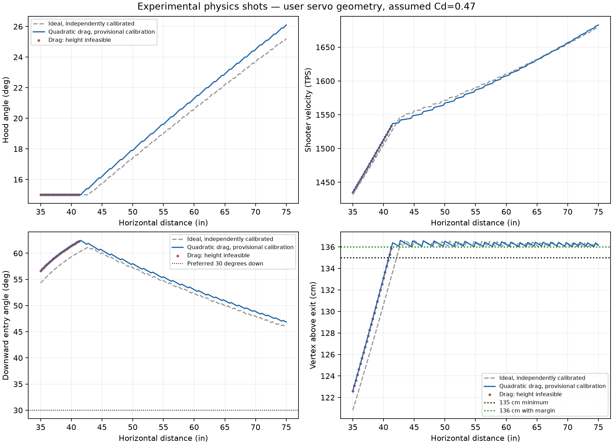
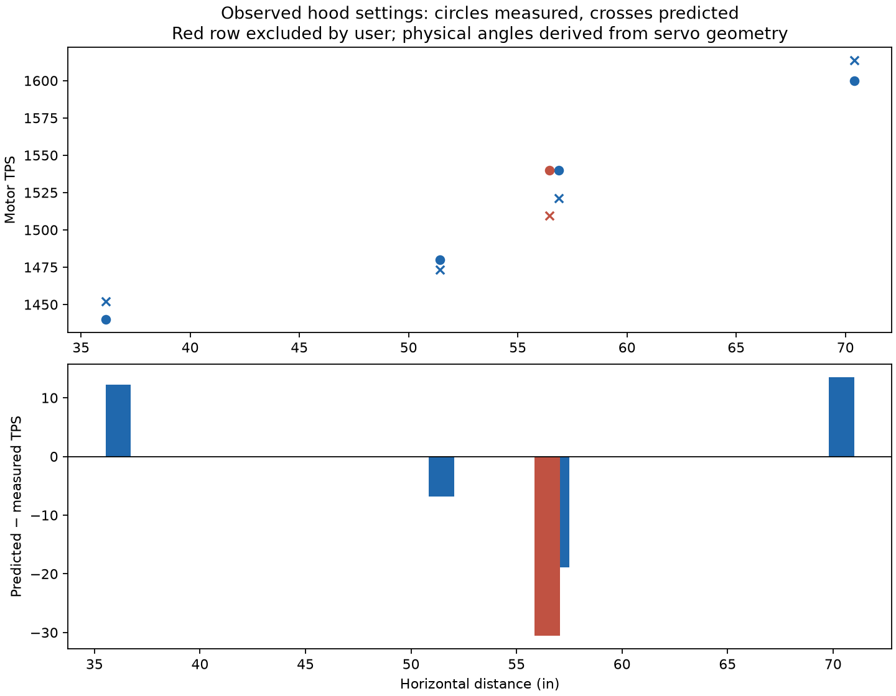
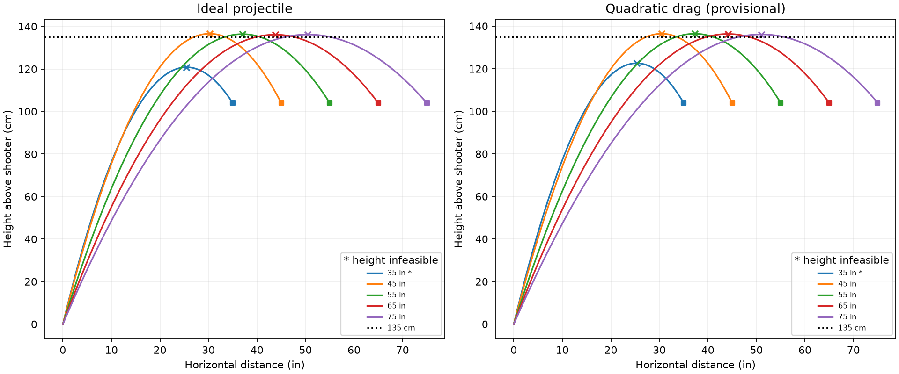

# Experimental physics shooter

This is an isolated stationary shooting experiment. `TeleOpRed`, the production
`Flywheel`, its four-row shot table, SOTM, and driver offsets are unchanged.
The experiment lives in `experimental/physics`; its OpMode binds its own hardware
and never calls production shooter, turret, or drivetrain subsystems. It shares
the configured alliance goals and Pedro Pinpoint pod configuration for localization.

## Use on the robot

To collect new empirical data without Dashboard configurables, use the separate
[Shooter Calibration Collector](ShooterCalibrationCollector.md). It provides
manual controller-based hood/TPS adjustment and pre-feed CSV snapshots, rather
than asking the unvalidated physics optimizer to choose the calibration shots.

Select **Physics Shooter Test** under **Experimental**. Align the robot/turret
manually toward the goal; the OpMode does not drive or aim the turret. Distance
is now calculated automatically every loop from Pedro's measured field pose:
`hypot(goal.x - pose.x, goal.y - pose.y)` in inches, not a slant range. The turret
is approximately 4 mm from the tracked point, so that offset is neglected here.
Goal 2 is selected when measured Y >70.75 inches; otherwise goal 1, using the
configured Red alliance coordinates. The target is 104 cm above the shooter exit.
Place the robot at (8.2,7.3) inches, heading 90 degrees, before initialization or
Circle reset. Pedro localization updates once per loop; it does not command motors.

- Cross: toggle flywheel operation. The OpMode starts with the flywheel stopped.
- Right bumper held: open the gate and feed using both intake motors at 1100 TPS,
  with only the left intake encoder supplying feedback.
- Triangle: allow/disallow the height-infeasible fallback. Default is disallowed.
- D-pad left/right: decrease/increase velocity multiplier by 0.01 per press.
- D-pad down/up: subtract/add 20 TPS of velocity offset per press.
- Circle: stop, disallow fallback, reset the starting robot pose, and restore
  multiplier 1.00 / offset 0 TPS, including when D-pad buttons are held.

Final target is `max(0, multiplier * originalLutTPS + offsetTPS)` while shooting
is enabled and the LUT shot is valid/allowed. The multiplier starts at 1.00 and
cannot go below zero; the offset starts at zero and may be positive or negative.
Holding a D-pad button does not repeat. Telemetry shows multiplier, offset,
original LUT TPS, adjusted TPS, and the actual commanded target. The original
LUT and hood setting are unchanged by trim. Trajectory/feasibility diagnostics
describe the **unadjusted LUT shot**; they are not re-simulated after driver trim.

The hood moves to the previewed shot after START. The motor is enabled only when
Cross is toggled on and the solution is feasible, or fallback is explicitly enabled.
Controls act once per press. Stop closes the gate and zeros all three motors.
No Dashboard configuration is exposed. Servo commands remain inside 0.16–0.485.
The D-pad no longer controls distance. Real pose-based distances outside 35–75
inches are reported as invalid and disable shooting; they are not clamped to a
different shot. This remains a stationary-shot test, with no velocity lead/SOTM.

Telemetry reports hood/launch/entry angles, TPS, flight time, vertex height and
location, feasibility, and loop period. These are model predictions, not measured
trajectory feedback. This experiment intentionally ignores robot motion.

## What is measured versus assumed

The screenshot contains robot X/Y, successful pre-shot TPS and **servo positions**.
The user confirms BIOBUZZ Pollen at 2.8 inches / 25 g, linear servo output,
355 degrees of full travel across 500–2500 us, 600–2400 us active PWM limits,
30/148 hood travel relative to servo travel, and servo 0.485 = 15 degrees.
These replace the earlier approximate 36 +/-2 degree endpoint assumption:

```
PWM fraction = (2400 − 600) / (2500 − 500) = 0.9
hood degrees per normalized servo position = 355 * 0.9 * 30 / 148
                                         = 64.7635135135
hoodDegrees = 15 + (0.485 − servoPosition) * 64.7635135135
servoPosition = 0.485 − (hoodDegrees − 15) / 64.7635135135
```

Thus servo 0.16 maps to **36.0481419 degrees**, 0.30 maps to **26.98125 degrees**,
and 0.25 maps to **30.2194257 degrees**. These historical angles are derived from
the supplied geometry, not marked as direct measurements: their raw measured
angle fields remain blank in `tools/physics_shooter/measurements.csv`.

The experiment explicitly sets the hood PWM to **600–2400 us** so it agrees with
the 90%-travel calculation. Using 500–2500 us would invalidate this mapping.
The requested optimization limit remains 15–36 degrees; exactly 36 degrees is
commanded at servo **0.16074335**, inside the allowed 0.16–0.485 servo interval.
Production TeleOp and its servo configuration are not edited by this change.
The physics model remains provisional because effective Cd and actual launch-angle
offset remain unmeasured; knowing the hood geometry does not identify those.

Other fixed assumptions:

| Quantity | Value | Basis |
|---|---|---|
| Gravity | 9.80665 m/s² | task specification |
| Target height above exit | 1.04 m | user's corrected target height |
| Minimum vertex + safety margin | 1.35 + 0.01 m | task specification |
| Preferred downward entry | 30 degrees from horizontal | user's updated preference; lower priority than peak height |
| Physical hood range | 15–36 degrees | task specification |
| Launch angle | 90 − hood + 0 degrees | geometric baseline; offset not fitted |
| Pollen diameter | 0.07112 m (2.8 in) | nominal AndyMark specification |
| Pollen mass | 0.02494758 kg (0.055 lb) | nominal AndyMark specification |
| Air density | 1.225 kg/m³ | assumed sea-level standard atmosphere |
| Effective Cd | 0.47 | assumed, **not measured or fitted**; perforated ball may differ |
| Spin/Magnus | absent | initial zero-spin model |
| Maximum motor TPS | unspecified | no hardware limit invented; power controller still clips 0–1 |

Manufacturer source: [AndyMark BIOBUZZ Scoring Elements](https://andymark.com/products/biobuzz-scoring-elements?variant=47194281181356).
The user independently confirms the 2.8-inch / 25 g nominal Pollen specification.
Listed ball size/mass are nominal; weigh and measure the actual balls if needed.

The supplied travel and gear relationship determine commanded hood geometry;
backlash, servo accuracy, mechanical flex, or ball-release behavior can still
create physical launch-angle error. No angle uncertainty distribution is fitted.

## Derivation and numerical model

All simulation distances use meters. `d = hypot(robotX − 56, robotY − 59) * 0.0254`.
This keeps the confirmed configured goal (56,59), rather than Desmos's old (57,59).
The user-removed 56.4537-inch row is retained for comparison only and excluded from
fitting and the interpolation baseline. It is not restored to production.

Without drag:

```
x(t) = v cos(theta) t
z(t) = v sin(theta) t − g t² / 2
t_goal = d / (v cos(theta))
v_required² = g d² / [2 cos²(theta) (d tan(theta) − h)]
```

Reject a nonpositive denominator. Compute the goal's vertical velocity as
`vz_goal = v sin(theta) − g t_goal`; descending entry requires `vz_goal < 0`.
The ideal vertex is `v² sin²(theta)/(2g)` at
`x_vertex = v² sin(theta) cos(theta)/g`.
Downward entry angle is `atan2(−vz_goal, vx_goal)` in degrees.
For preferred downward entry `beta`, the ideal launch angle is
`theta = atan(2h/d + tan(beta))`. The current preference is 30 degrees; the
attachment's original 45-degree / 113 cm reference is retained only as a
separate analytic validation fixture.

For quadratic drag, let `q = rho Cd A/(2m)`, `A = pi diameter²/4`:

```
dx/dt = vx                  dz/dt = vz
dvx/dt = −q |v| vx           dvz/dt = −g − q |v| vz
```

The offline RK4 integrator uses horizontal x as its independent variable:

```
dz/dx = vz/vx               dt/dx = 1/vx
dvx/dx = −q |v|             dvz/dx = (−g − q |v| vz)/vx
```

This reaches the target x exactly. It rejects stopped/nonfinite trajectories and
interpolates the vertex at vz=0. Bracketing and 23 bisection steps find the exit
speed that intersects (d,1.04). Finer 400-step integrations independently check
midpoints between LUT entries. The Python simulator can return full coordinates;
representative trajectory CSV files are exported alongside plots.

For each distance the offline optimizer enumerates hood settings at 0.1-degree
resolution, including both mechanical endpoints. It first discards ascending,
invalid, or target-missing solutions. It then restricts selection to vertex
height >=136.01 cm (1 cm margin plus 0.01 cm numerical reserve), with the vertex
before the goal. Among these it minimizes entry-angle error from 30 degrees;
errors within 0.01 degree are treated as equivalent and lower TPS breaks that tie.
If none meets the height constraint, it chooses the **highest vertex** among
descending, target-intersecting solutions and marks feasibility false. There is
no weighted score that exchanges height or descent for entry angle.

The optimum is still discretized and provisional; it is not proof of robustness
to ball compression, launch scatter, motor lag, or all intermediate hood settings.

## Calibration and comparison

For the fixed Cd/launch-angle assumptions and user-supplied servo geometry, calculate required exit speeds at
each historical hood setting. Fit `v_exit = k * preShotTPS + b` by least squares
in speed space, requiring positive k and positive speed over the calibration range.
The user confirms the Desmos shots did **not** share a constant entry angle.
Their entry angles were not measured and are not constrained to 30 or 45 degrees
during calibration. Each row's recorded hood setting determines its launch angle;
the speed solver requires target intersection, and entry angle is a resulting
prediction. The 30-degree preference applies only to selection of new optimized
shots, not to reconstructing historical trajectories.
The fit does **not** use the minimum flywheel speed during ball contact. All TPS
values refer to the motor encoder. The user confirms a 2:1 reduction, so 1600
motor TPS corresponds to 800 flywheel TPS in that convention; the empirically
fitted transfer already includes this gearing. Do not divide LUT commands by two.

```
k = 0.003003057977 (m/s) / (tick/s)
b = 0.922736436 m/s
TPS_required = (v_required − b) / k
```

This affine model is local to the tested shooting regime; its nonzero intercept
does not predict motion at a stopped motor. The generator rejects nonpositive
scaling. Neither Cd nor angle offset is inferred from these four shots. Three hood
angles are derived from the supplied geometry, rather than separately measured;
fitting all four unknowns from these sparse successful shots is not justified.

| Distance (in) | Servo | Hood (deg) | Measured TPS | Predicted TPS | Error TPS | Absolute error % |
|---|---|---|---|---|---|---|
| 36.1201 | .485 | 15 confirmed | 1440 | 1452.20 | +12.20 | .847 |
| 51.4406 | .300 | 26.9813 derived | 1480 | 1473.20 | −6.80 | .460 |
| 56.8872 | .250 | 30.2194 derived | 1540 | 1521.06 | −18.94 | 1.230 |
| 70.4111 | .250 | 30.2194 derived | 1600 | 1613.54 | +13.54 | .846 |
| 56.4537 **excluded** | .300 | 26.9813 derived | 1540 | 1509.39 | −30.61 | 1.987 |

Training RMSE = **13.57 TPS**, MAE = **12.87 TPS**. Leave-one-out refitting of k/b
gives RMSE **42.46 TPS**, MAE **34.89 TPS**. The excluded row's residual
could reflect release variation or mapping/model error; no cause is established.
The fit overpredicts the shortest and longest measured shots and underpredicts
the middle pair, suggesting remaining model mismatch; four rows cannot establish
its cause. The corrected 104 cm height is used for both calibration and optimization.

The distance-only piecewise interpolation baseline has zero training error by
construction. Its leave-one-out endpoint-held RMSE is **41.81 TPS**, MAE **39.83 TPS**.
This is not an independent experimental validation of the physics model: only four
rows are available, most hood angles are geometrically derived, and the interpolation
baseline follows historical hood choices while the physics optimizer selects new
ones. Do not extrapolate these small-data scores into scoring accuracy.

Full exact values, residuals, and metadata: [calibration JSON](physics-shooter/calibration.json)
and [measurement CSV](physics-shooter/measurement_comparison.csv).

## Predictions and plots

The provisional drag model first reaches 136 cm at the **41.5-inch grid point**.
At 35 inches the highest allowed arc reaches about **122.59 cm**, so it is a
descending fallback and height-infeasible. In the ideal model the same maximum
75-degree launch reaches about **120.82 cm**, also infeasible. Feasibility thresholds
depend on Cd, angle calibration, target height, and margin.

The preferred entry is now **30 degrees downward from horizontal**. Under the
current 104 cm target and 136 cm minimum peak, actual selected entries remain
steeper: the height requirement takes precedence. Telemetry reports the preferred
angle and the nominal LUT entry-angle error. Driver velocity trim can further
change the physical entry angle; those diagnostics describe the unadjusted LUT.

See [five-inch output table](physics-shooter/predictions.md), the full
[drag LUT](physics-shooter/drag.csv), and the independently calibrated
[ideal baseline](physics-shooter/ideal.csv).







## Runtime cost and regeneration

The generated Kotlin table contains 161 distances from 35–75 inches in 0.25-inch
steps, including feasibility and trajectory diagnostics. `PhysicsShooter.calculateShot`
uses direct indexing of the uniform grid plus linear interpolation, O(1) and no
allocation when reusing a `PhysicsShot`. No integration, optimization, file reads,
or runtime Python occurs on the robot. Numeric payload is roughly 11 kB.
At a feasibility boundary both neighboring entries must be feasible before
claiming success; out-of-range or nonfinite input clears the result rather than
silently reusing a prior shot. The reported vertex/entry/time between grid points
are interpolated estimates. Independent midpoint integration found maximum target
height error **0.0046 mm** with this table and no false height-feasible midpoint.
That is numerical model agreement, not physical ball-flight accuracy.

The test OpMode updates the pose-based distance and inexpensive lookup each loop.
Velocity feedback remains full-rate, motor/servo writes are cached, Lynx bulk
caching is manual, and telemetry runs at 5 Hz. Physical loop latency still depends
on the Control Hub; this does not establish a measured 20 ms period.

To regenerate, install `tools/physics_shooter/requirements.txt`, then from repo root:

```
python -m unittest discover -s tools/physics_shooter -p test_physics.py -v
python tools/physics_shooter/generate.py
```

The script overwrites only experimental `PhysicsShotTable.kt` and
`doc/physics-shooter` outputs. Use `--cd`, `--distance-step`, and `--hood-step`
to evaluate assumptions. Regenerate and rerun numerical validation after changes;
the human-readable summary values in this document describe the default scenario.
There is no arbitrary hard motor TPS limit in the current project to enforce.
If measured hardware limits become available, add them to candidate rejection.

## Measurements that improve this model

1. Measure physical hood angle at servo .485, .30, .25 and .16, plus intermediate
   settings. Confirm the 15–36-degree mechanical limits and linkage mapping.
2. Repeat shots at multiple distances **and multiple measured hood angles** per
   distance. Record settled pre-shot TPS and scoring/miss scatter, not just successes.
3. Measure ball exit speed and launch angle with high-speed video or gates.
   This separates transfer losses and angle error from aerodynamic effects.
4. Measure flight time or intermediate trajectory heights to constrain effective
   Cd. Repeat with several balls; nominal mass and perforations are not enough.
5. Measure shooter-exit-to-goal height and practical maximum TPS under battery load.

No spin lift, wind, ball-size/goal-clearance geometry, impact, or robot-motion terms
are included. The calibrated angle and drag uncertainty may dominate the very
small numerical residual. Keep production on the existing empirical setup until
the experimental shots are physically validated.
